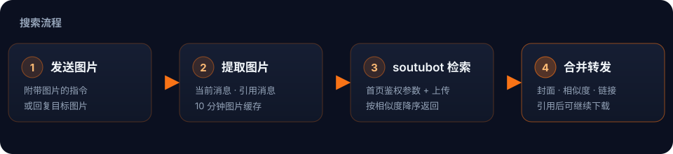
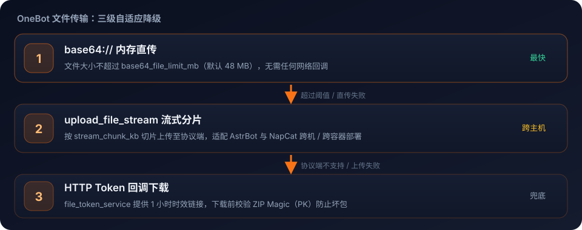

<div align="center">
  
</div>

<h1 align="center">astrbot_plugin_searchmanga</h1>

<p align="center">
  <b>以图搜本子</b> · 搜图 · 合并转发 · 一键打包下载
</p>

<p align="center">
  <a href="https://github.com/AstrBotDevs/AstrBot"></a>
  <a href="https://www.python.org/"></a>
  <a href="CHANGELOG.md"></a>
  <a href="LICENSE"></a>
  <a href="https://github.com/the-snowpear/astrbot_plugin_searchmanga"></a>
  <a href="https://github.com/the-snowpear/astrbot_plugin_searchmanga/stargazers"></a>
  <a href="https://github.com/the-snowpear/astrbot_plugin_searchmanga/commits/master"></a>
</p>

<p align="center">
  <a href="README.md">简体中文</a> · <a href="README_EN.md">English</a>
</p>


> 基于 [soutubot.moe](https://soutubot.moe) 的以图搜漫画 / 同人志 AstrBot 插件：把图片丢给机器人，它会把出处以 QQ 合并转发回给你，还能顺手把整本打包下载下来。

---

## 📖 目录

- [✨ 核心特性](#-核心特性)
- [🔍 搜索流程](#-搜索流程)
- [📦 安装指南](#-安装指南)
- [🎮 使用方法与交互指令](#-使用方法与交互指令)
- [🌐 支持的平台与画册源](#-支持的平台与画册源)
- [🚀 OneBot 文件传输架构](#-onebot-文件传输架构)
- [⚙️ 配置项详解](#️-配置项详解)
- [🤖 LLM Function Calling](#-llm-function-calling-智能体工具调用)
- [🧩 项目结构](#-项目结构)
- [✅ 兼容性](#-兼容性)
- [❓ 常见问题与排错指南](#-常见问题与排错指南-faq)
- [📄 开源许可](#-开源许可)

---

## ✨ 核心特性

- 🔍 **精准以图搜本**：借助 [soutubot.moe](https://soutubot.moe) 引擎，反向检索图片出自的同人志 / 漫画作品，支持配置搜索精度（`factor`）。
- 📑 **合并转发节点呈现**：搜索结果以 QQ 合并转发展示，清晰呈现封面图、相似度、来源站点、标题与详情链接，拒绝刷屏。
- 📥 **智能上下文下载**：
  - 引用搜索结果合并消息，回复「`下载第1个`」或「`下载 2`」即可下载。
  - 支持直接输入本子链接或 JM 号一键下载。
- 📦 **多源画册解析打包**：内置 nHentai、E-Hentai、ExHentai、Panda、JMComic 等站点的并发抓图与归档，自动校验并压缩为 ZIP。
- 🚄 **三级 OneBot 文件传输**：Base64 直传 → NapCat 流式分片 → HTTP Token 回调，自适应降级。
- 🛡️ **群聊细粒度管控**：可为不同群单独配置是否展示封面预览、是否允许下载。
- 🤖 **LLM 工具集成**：注册 `search_doujin_by_image` 与 `download_doujin`，模型可自主感知意图并调用。

---

## 🔍 搜索流程



从「一张图」到「一条合并转发」，中间只有一次 soutubot 请求；图片会按会话缓存 10 分钟，所以先发图、再补一句 `/搜本子` 也能命中。

---

## 📦 安装指南

### 方式一：AstrBot 插件市场一键安装（推荐）

1. 打开 AstrBot Web 管理面板。
2. 进入「扩展 / 插件市场」，搜索 `astrbot_plugin_searchmanga`。
3. 点击「安装」并重启或重新加载插件。

### 方式二：手动 Git 克隆

进入 AstrBot 根目录下的 `data/plugins/` 目录：

```bash
cd data/plugins
git clone https://github.com/the-snowpear/astrbot_plugin_searchmanga.git
```

### 安装 Python 依赖

在 AstrBot 的 Python 环境中安装依赖：

```bash
pip install -r data/plugins/astrbot_plugin_searchmanga/requirements.txt
```

---

## 🎮 使用方法与交互指令

### 1. 基础指令

| 指令 | 别名 | 附带参数 | 说明 |
| :--- | :--- | :--- | :--- |
| `/搜本子` | `/搜本`, `/soutu` | 可选附带图片 | 发送带图片的指令，或发送指令后回复目标图片 |
| `/下载本子` | `/下载`, `/dl`, `/下本` | `<序号 / URL / JM号>` | 下载搜索列表中的指定序号、画册 URL 或 JM 号 |

> **提示**：插件拥有图片缓存机制（默认保留 10 分钟）。在群里发图后，直接在下一条消息发送 `/搜本子` 也能自动捕获刚才那张图。

### 2. 自然语言与引用交互

- **引用回复下载**：引用机器人返回的搜索结果合并转发消息，直接回复：
  - `下载第1个` / `下载第一个`
  - `下载 2` / `下本子 3`
  - `帮我下载第4本`
- **JM 号直接下载**：
  - `下载 JM123456`
  - `下载 jm 123456`
  - `JM123456 下载`
- **链接直接下载**：
  - `下载 https://nhentai.net/g/xxxxxx/`
  - `下载 https://e-hentai.org/g/xxxxxx/xxxxxx/`

---

## 🌐 支持的平台与画册源

| 平台名称 | 模式 | 说明 |
| :--- | :--- | :--- |
| **nHentai** | 逐页高清抓图 | 支持多域名（`nhentai.net`, `nhentai.xxx` 等），自动重试与代理加速 |
| **E-Hentai** | 归档 / 逐页抓取 | 优先尝试 `archiver.php` 归档直下，失败自动回退逐页抓取；支持配置 Cookie |
| **ExHentai** | 归档 / 逐页抓取 | 里站画册，需在配置项中填写有效 `exhentai_cookie`（含 `igneous`, `ipb_member_id`, `ipb_pass_hash` 等） |
| **Panda** | 归档直下 | 针对熊猫归档站点的快速打包下载 |
| **JMComic (禁漫)** | 章节抓取 / 解密 | 基于 `jmcomic` SDK，支持 `JMxxxxxx` 纯数字 ID 或画册链接直接下载 |

---

## 🚀 OneBot 文件传输架构

为适配不同网络拓扑（尤其是 AstrBot 与 NapCat 分别部署在不同机器 / 不同容器中），插件设计了三级自适应传输链路：



1. **Base64 直传（`base64://`）**：体积小于阈值（默认 48 MB）的压缩包直接编码传输，无网络回调依赖。
2. **流式分片上传（`upload_file_stream`）**：大文件按 `stream_chunk_kb` 切片，逐块上传至协议端本地，天然解决跨主机文件共享问题。
3. **HTTP 校验降级**：通过 AstrBot `file_token_service` 提供 1 小时时效的下载链接，传输前校验 Magic Header（`PK`），防止协议端把错误页面当成 ZIP 保存。

---

## ⚙️ 配置项详解

在 AstrBot WebUI「插件配置」中按需调整：

### 完整配置参数表

| 配置项 | 类型 | 默认值 | 提示说明 |
| :--- | :---: | :---: | :--- |
| `max_results` | `int` | `5` | 合并转发中展示的最多条目数（按相似度降序） |
| `similarity_threshold` | `int` | `28` | 低相似度警告阈值（%），低于该值标注 `⚠ 低相似度` |
| `factor` | `float` | `1.2` | soutubot 搜索精度参数（普通 1.2，严格 1.4） |
| `timeout` | `int` | `60` | soutubot 搜图 HTTP 超时（秒） |
| `node_name` | `string` | `"搜本子"` | 合并转发节点外显昵称 |
| `node_uin` | `int` | `10000` | 节点 QQ 兜底号（优先使用机器人自身 QQ 号） |
| `send_preview_image` | `bool` | `true` | 全局默认：是否附带封面预览图 |
| `allow_download` | `bool` | `true` | 全局默认：是否允许群员使用下载功能 |
| `download_concurrency` | `int` | `4` | 逐页抓图最大并发数（过高易被站点限流） |
| `download_timeout` | `int` | `600` | 下载与压缩总超时（秒） |
| `base64_file_limit_mb` | `int` | `48` | Base64 直传上限（MB），填 0 表示禁用并直接走流式或回调 |
| `stream_chunk_kb` | `int` | `256` | NapCat 流式上传分块大小（KB） |
| `ehentai_cookie` | `string` | `""` | 可选。E-Hentai 登录 Cookie |
| `exhentai_cookie` | `string` | `""` | 可选。ExHentai 里站 Cookie（必须含有效凭证） |
| `prefer_archive_download` | `bool` | `true` | 是否优先尝试归档直下 |
| `proxy_enabled` | `bool` | `false` | 是否开启网络代理 |
| `proxy_policy` | `string` | `"download_only"` | 代理作用范围策略（见下文） |
| `proxy_url` | `string` | `"http://127.0.0.1:7897"` | 代理地址（HTTP / HTTPS / SOCKS5） |
| `file_callback_base` | `string` | `""` | 协议端访问 AstrBot 文件的基础 URL（如 `http://192.168.1.100:6185`） |
| `group_settings` | `list` | `[]` | 群聊个性化独立设置列表 |

### 群聊个性化配置模板

```json
[
  {
    "group_id": "123456789",
    "send_preview_image": false,
    "allow_download": true
  },
  {
    "group_id": "987654321",
    "send_preview_image": true,
    "allow_download": false
  }
]
```

### 网络代理策略选择

- `disabled`：完全不走代理。
- `download_only`（**推荐**）：仅下载图片时走代理，**搜图请求直连**，避免 soutubot 对代理 IP 拦截触发 403 / Cloudflare 校验。
- `search_only`：仅搜图请求走代理。
- `all`：搜图与下载全部走代理。

---

## 🤖 LLM Function Calling (智能体工具调用)

插件原生接入 AstrBot 的 Tool Calling / Function Calling：

### 1. `search_doujin_by_image`

- **用途**：用户想查询图片出处、搜索同人志 / 漫画时由模型自主调用。
- **参数**：
  - `image_url` (*string*)：图片 URL；留空时自动提取用户最近发送的图片。

### 2. `download_doujin`

- **用途**：用户要求下载漫画、下载搜索列表某项、或提供链接 / JM 号时调用。
- **参数**：
  - `url` (*string*)：本子链接（nHentai / E-Hentai / ExHentai / JMComic 等）。
  - `index` (*number*)：最近一次搜索结果中的条目序号（如 `1`）。
  - `jm_id` (*string*)：JMComic 纯数字 ID（如 `123456`）。

---

## 🧩 项目结构

```text
astrbot_plugin_searchmanga/
├── main.py            # 插件入口：指令、LLM 工具、合并转发、下载编排
├── soutubot.py        # soutubot.moe 检索客户端（鉴权参数、请求封装）
├── downloaders.py     # 各站点画册抓取与 ZIP 打包
├── onebot.py          # OneBot 协议交互（转发、引用、文件上传）
├── parsing.py         # 链接 / 文本解析与文件名清洗
├── models.py          # 数据模型（SearchEntry / DownloadIntent）
├── constants.py       # 代理策略等常量
├── _conf_schema.json  # WebUI 配置项定义
├── metadata.yaml      # 插件元信息
├── docs/              # 文档视觉素材（SVG / 图标）
└── tests/             # 解析与链接生成的单元测试
```

---

## ✅ 兼容性

| 项目 | 状态 |
| :--- | :--- |
| AstrBot | 4.x（已按 **4.29.1** 核对所用接口） |
| Python | 3.12 / 3.13 / **3.14** |
| 平台 | `aiocqhttp`（OneBot v11） |
| 协议端 | NapCat / Lagrange 等支持 `send_group_forward_msg` 的实现 |

> **v0.2.1 修复**：AstrBot 在 Python 3.14 上改用 pydantic v2 直接校验消息组件，不再做 `int -> str` 隐式转换。此前 `Node.uin` 传入整数会在构造合并转发节点时抛 `ValidationError`，导致搜索结果发不出去；现已显式转换为字符串。详见 [CHANGELOG](CHANGELOG.md)。

---

## ❓ 常见问题与排错指南 (FAQ)

#### Q1: 搜本子提示 `搜索失败: ... 提示: soutubot 对代理敏感`？

**答**：soutubot 部署了严格的 Cloudflare 与代理检测机制。请将 `proxy_policy` 设置为 `download_only`，保证搜图请求直连 soutubot。

#### Q2: 跨机器部署时，群文件发送失败或下载到的 ZIP 损坏？

**答**：

1. 确保 NapCat 已更新至支持 `upload_file_stream` 的版本。
2. 若采用 HTTP 回调下载，请在 `file_callback_base` 中填写 NapCat 所在机器**能连通**的 AstrBot IP 与端口（例如 `http://192.168.1.50:6185`），不要填 `127.0.0.1`。

#### Q3: ExHentai 下载返回 403 或无法解析？

**答**：里站需要配额有效的 Cookie。请在 `exhentai_cookie` 中填入完整 Cookie 字符串（必须包含 `ipb_member_id`、`ipb_pass_hash`、`igneous` 等字段）。

#### Q4: 升级到 Python 3.14 后，合并转发突然发不出来？

**答**：这是 v0.2.0 的已知问题，升级到 **v0.2.1** 即可修复（`Node.uin` 类型转换）。

---

## 📄 开源许可

本项目基于 [MIT License](LICENSE) 协议开源。

> 本项目仅做图片检索与文件打包，内容均来自第三方站点，请自行确认所在地区法律法规以及所在群聊的接受度。
